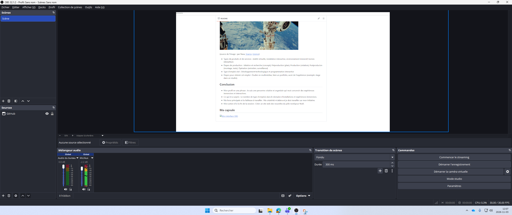

# analyse-domaine
# Analyse du domaine — Léa Martel

## Découverte de soi

- Mes forces : organisation, créativité
    - Exemple : Je crée des maquettes avec du matériel recyclé dans mes temps libres. Je fais le plan et la construction.
- Mes faiblesses ou points à améliorer : initiative
    - Exemple : J'ai tendance à préférer suivre des directions claires.
- Seul(e) ou en équipe : En équipe
    - Pourquoi et exemple : Cela permet de faire de plus grands projets. Par exemple, à l'école secondaire, j'ai fait des costumes our le spectacle de Noël de l'école. On a pu en faire plusieurs en peu de temps puisqu'on était plusieurs, en plus de se partager nos connaissances.
- Plutôt technique ou créatif : technique

## Exploration des domaines

| Domaine | Intérêt | Pourquoi |
|---|---|---|
| Graphisme | faible | J'aime moins le dessin et les arts visuels. |
| Vidéo et animation 2D | moyen | J'aime découvrir les techniques de montage vidéo. |
| 3D | moyen | J'aime découvrir comment créer des objets en 3D. |
| Web | fort | J'aime voir le résultat concret de ce que je crée. |
| Jeux vidéo | faible | Je m'en lasse rapidement, car c'est souvent répétitif. |
| Développement logiciel | fort | J'aime apprendre à programmer. |
| Installations et expériences immersives | fort | C'est intéressant les façons de mélanger le numérique et les espaces réels. |

## Mes 2 domaines préférés

### Domaine 1 : Installations et expériences immersives

- Expérience : Aucune, la technique peut m'aider a m'y initier (audio, projection, ect).
- Logiciels et outils : J'aimerais apprendre à utiliser un casque de réalité augmenté, des capteurs de mouvements et des projecteurs.
- Pourquoi il m'intéresse : Ce sont des projets concrets et ils permettent de faire vivre une expérience et pas seulement d'être derrière un écran.
- Travailler dans ce domaine : Je me vois travailler dans ce domaine, car c'est créatif tout en utilisant différentes technologies. Je trouve que le résultat est toujours impressionnant.

### Domaine 2 : Web

- Expérience : Cours de web 1, où j'ai commencé à voir le HTML et le CSS.
- Logiciels et outils : Je connais Visual Studio Code.
- Pourquoi il m'intéresse : Le résultat est concret et je vois directement ce que je crée.
- Travailler dans ce domaine : Je ne travaillerais pas nécessairement dans ce domaine, mais ça peut être des projets personnels.

## Les caractéristiques de mon domaine préféré

- Types d'entreprises : Startups, Organismes, Instituts culturels, diffuseurs
- Exemple d'entreprise : Infinity Experiences (Coentreprise fondée par Studio PHI et Felix et Paul Studios)

(source de l'image : https://ctvm.info/nouvelle-coentreprise-entre-studio-phi-et-felix-paul-studios/)

- Types de produits et de services : réalité virtuelle, installation interactive, environnement immersif, bornes interactives
- Étapes de production : Idéation et recherche (concept), Préproduction (plan), Production (création), Postproducion (montage, tests), Opération (entretien, surveillance)
- Type d'emploi visé : Développement technologique et programmation interactive
- Étapes pour obtenir cet emploi : Étudier en multimédias, faire un portfolio, avoir de l'expérience (exemple: stage dans un studio).

## Conclusion

- Mon profil en une phrase : Je suis une personne créative et organisée qui veut concevoir des expériences immersives et interactives.
- Ce qui m'a surpris : Le nombre de type d'emplois dans le domaine d'installations et expériences immersives.
- Ma force principale et la faiblesse à travailler : Ma créativité m'aidera et je dois travailler sur mon initiative.
- Mon action d'ici la fin de la session : Créer un site web des nouvelles du pôle nord pour Noël.

## Ma capsule

